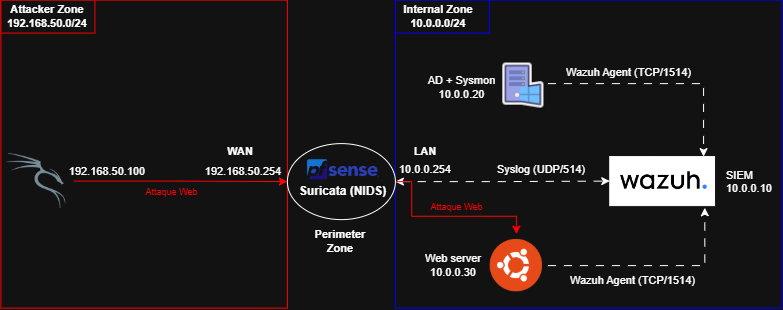
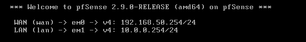
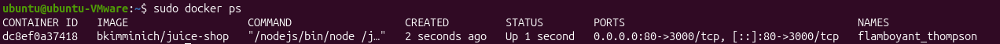
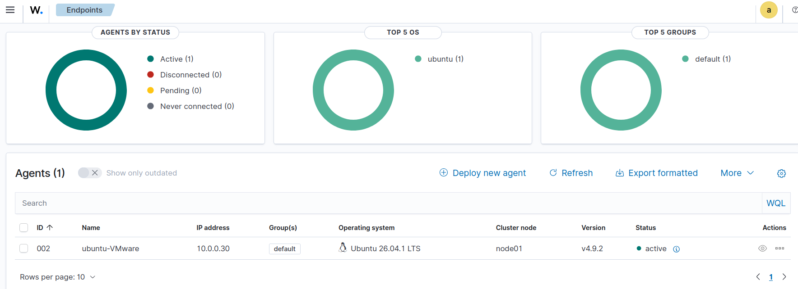
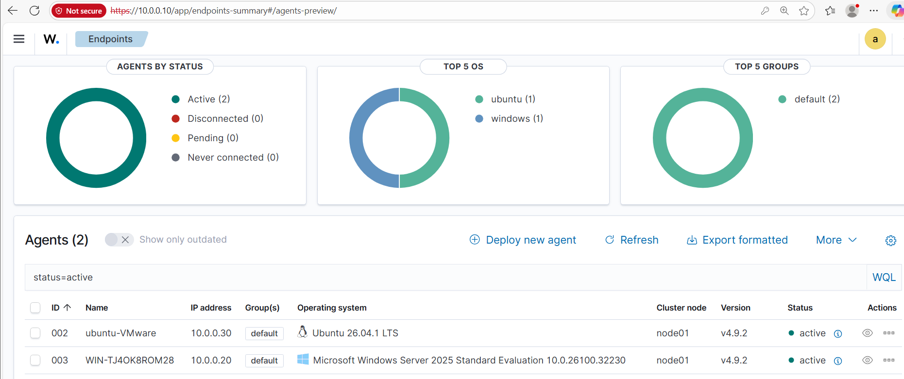
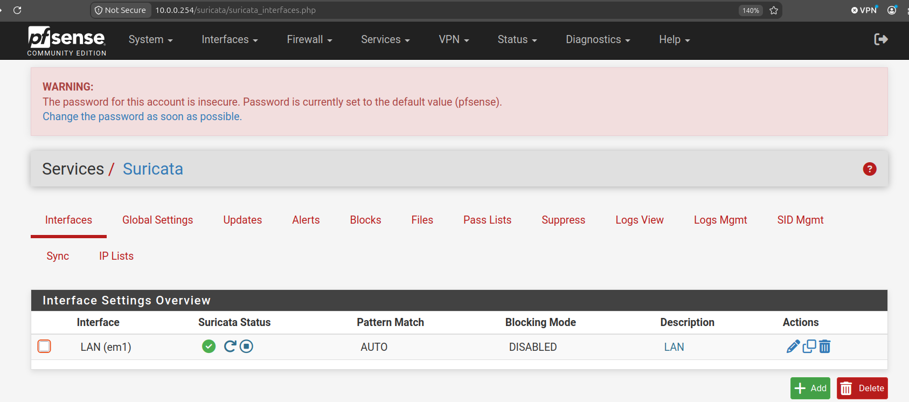
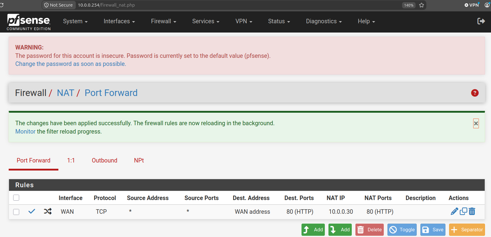
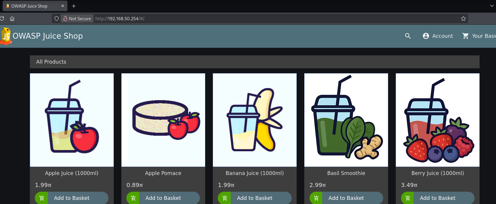
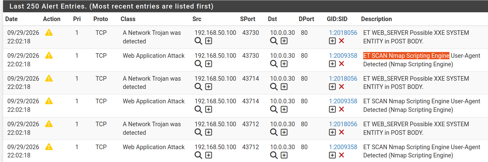

# Hybrid SOC — Network and Endpoint Threat Detection

**pfSense · Suricata · Wazuh · Windows Server / Sysmon · Ubuntu · Docker / OWASP Juice Shop · Kali Linux**

!!! info "Project status — evolving documentation"
    This SOC laboratory is under active evaluation and continuous improvement. The documentation captures the current architecture, available evidence, detection logic and reproducible security exercises; it is **not a frozen final release**. Test coverage, investigation records and supporting screenshots are updated as the laboratory evolves.

A virtualized cybersecurity laboratory combining perimeter monitoring, endpoint telemetry, centralized event analysis, detection engineering and structured incident investigation. The environment separates an external attacker segment from a protected internal network and uses deliberately vulnerable web infrastructure for controlled security validation.

**SOC workflow:** network segmentation → traffic inspection → host monitoring → log collection → rule-based classification → analyst triage → controlled response → detection-quality assessment.

> **Scope:** All IP addresses belong to a private virtual laboratory. Attack examples target only owned or explicitly authorized lab resources.

## 1. Context and business objectives

Modern SOC teams do more than install intrusion detection software: they must collect usable telemetry from heterogeneous assets, recognize meaningful threats, reconstruct the events surrounding an alert and select responses appropriate to the risk. This project models that workflow in a compact virtual enterprise environment.

The engineering scope covers:

- creating a clear trust boundary between an untrusted network and protected internal systems;
- exposing only the required application service through a controlled NAT rule;
- deploying a network intrusion detection sensor where inbound traffic becomes visible;
- using a central SIEM to organize endpoint and network security events;
- making endpoint telemetry actionable with Sysmon, Windows Security events, Linux logs and file integrity monitoring;
- defining version-controlled detection logic and benign/malicious test cases;
- formalizing analyst investigations and safe response mechanisms.

The project emphasizes **detection evidence, data-source quality, false-positive analysis and reproducibility**, rather than equating a vulnerability probe with successful exploitation.

## 2. Technical architecture



*Figure 1 — Segmented WAN/LAN environment, perimeter NIDS and centralized monitoring.*

### 2.1. Host inventory and network layout

| Zone | Component | IP / network | Function |
|---|---|---|---|
| Attacker / WAN | Kali Linux | `192.168.50.100/24` | Controlled reconnaissance and security tests |
| Perimeter / WAN | pfSense `em0` | `192.168.50.254/24` | Firewall ingress and port forwarding |
| Perimeter / LAN | pfSense `em1` | `10.0.0.254/24` | Internal gateway and Suricata IDS sensor |
| Protected / LAN | Wazuh stack | `10.0.0.10` | Manager, indexer and dashboard |
| Protected / LAN | Windows Server 2025 | `10.0.0.20` | Windows endpoint and Sysmon telemetry source |
| Protected / LAN | Ubuntu web server | `10.0.0.30` | Docker-hosted OWASP Juice Shop and Wazuh agent |

Two VMware **host-only** subnets form the network boundary: `VMnet1` for the simulated external zone (`192.168.50.0/24`) and `VMnet2` for internal assets (`10.0.0.0/24`). pfSense is dual-homed and performs routing and filtering between the zones.

### 2.2. Security responsibilities

**pfSense:** ingress filtering, NAT, management-plane access control and perimeter log production.

**Suricata:** packet inspection and Emerging Threats Open signature matching on the LAN-side interface. Its role here is **NIDS**: the captured configuration has blocking **disabled**.

**Wazuh:** endpoint agent management, log decoding, rules, alert handling, search and investigation. The all-in-one deployment uses Wazuh Manager, Wazuh Indexer and Wazuh Dashboard; a separate Elasticsearch cluster is not implied.

**Sysmon / Windows events:** richer endpoint process metadata, registry/file/network activity where enabled by the selected configuration, authentication and PowerShell auditing.

**Ubuntu/Docker:** vulnerable application hosting, Linux system events and file integrity data.

### 2.3. Data-flow and trust-boundary model

```text
Kali (192.168.50.100)             pfSense                     Enterprise LAN (10.0.0.0/24)
       |                              |                                  |
       +---- TCP/80 ----------------->| WAN 192.168.50.254               |
                                      | DNAT TCP/80  -----------------> Ubuntu 10.0.0.30:80
                                      |  Suricata IDS on LAN            |    | Docker Juice Shop :3000
                                      |                                  |    + Wazuh Agent
                                      |                                  |
                                      +------ telemetry path ---------> Wazuh 10.0.0.10
                                                                         ^
                                                                         |
                                                  Windows 10.0.0.20 -----+
                                                  Sysmon / Wazuh Agent
```

For NIDS events to be searchable in Wazuh, **pfSense system syslog and Suricata EVE JSON must be treated as separate sources**. Receiving firewall Syslog/UDP514 alone does not establish that structured Suricata alerts have arrived at the SIEM.

## 3. Infrastructure deployment

### 3.1. Segmentation and routing using pfSense

The VMware configuration separates the test traffic source from the internal machines. pfSense has two assigned NICs:

- `em0` (WAN): `192.168.50.254/24` on VMnet1;
- `em1` (LAN): `10.0.0.254/24` on VMnet2.

Clients in the protected subnet use `10.0.0.254` as their gateway. The pfSense web configurator is accessed from the LAN-side management network. As RFC1918 traffic is intentionally used on the simulated WAN, the WAN setting that blocks private source networks is adjusted for this isolated experiment. Such an exception must not be generalized to a real Internet-connected firewall.



*Figure 2 — pfSense interface assignments and IPv4 addresses.*

**Validation tools** for this boundary include `ip route`, `ping`, `traceroute`/`tracepath`, `tcpdump` and the pfSense Diagnostics/Firewall Logs screens. Policy verification distinguishes permitted web traffic from denied management and non-published ports.

### 3.2. Web application target

An Ubuntu server at `10.0.0.30` runs the deliberately vulnerable OWASP Juice Shop application in Docker. The host publishes container port 3000 on TCP port 80:

```bash
sudo apt update
sudo apt install docker.io -y
sudo systemctl enable --now docker
sudo docker run -d -p 80:3000 bkimminich/juice-shop
sudo docker ps
```

These are the container deployment commands used in the lab record. Docker may assign an autogenerated container name; use the container ID displayed by `docker ps` for subsequent inspections. Keep the published ports consistent with the NAT path.



*Figure 3 — Running Juice Shop container, with host port 80 mapped to container port 3000.*

### 3.3. Wazuh server

The centralized monitoring node operates at `10.0.0.10` within the internal network. Its functional components are:

1. **Wazuh Manager:** registration, rule evaluation, alert creation and response integration;
2. **Wazuh Indexer:** searchable event storage;
3. **Wazuh Dashboard:** agent inventory, hunting, visualization and alert investigation.

Wazuh agents report to the manager using the agent protocol (commonly TCP/1514). Enrollment-related ports, certificates and firewall access are administered separately. An online agent confirms connectivity; it does not, by itself, prove that any particular event channel has been ingested.

### 3.4. Ubuntu agent enrollment

The Ubuntu endpoint at `10.0.0.30` has a Wazuh agent. The initial enrollment was complicated by a network change from a dynamically assigned address to the isolated static internal subnet. A duplicate-agent-name condition was identified from `/var/ossec/logs/ossec.log`. Clearing the stale manager-side record and re-enrolling the endpoint restored connection.



*Figure 4 — Linux endpoint registered and active in Wazuh.*

### 3.5. Windows Server and Sysmon

A Windows Server 2025 virtual machine at `10.0.0.20` supplements the Linux host. The Wazuh Windows agent is installed, and Sysmon is included in the endpoint monitoring design. The endpoint telemetry configuration targets the `Microsoft-Windows-Sysmon/Operational` channel.

The reported agent-version compatibility issue was resolved by aligning the Windows agent with the manager version (the screenshot displays Wazuh agent **v4.9.2**). This version information should be interpreted as the **agent version** on the endpoint inventory, not a blanket assertion about every installed component.



*Figure 5 — Two active Wazuh agents: Ubuntu `10.0.0.30` and Windows Server `10.0.0.20`.*

### 3.6. Network intrusion detection with Suricata

Suricata is installed as a pfSense package and runs on the LAN interface (`em1`). The sensor inspects network traffic entering the protected network, using Emerging Threats Open signatures for network- and application-layer matching.



*Figure 6 — Suricata active on LAN with `Blocking Mode: DISABLED`; detection mode, not prevention mode.*

## 4. Offensive simulation and network detection

### 4.1. External attack origin

Kali Linux at `192.168.50.100` represents the untrusted source. The separation from `10.0.0.0/24` ensures inbound application requests cross the pfSense perimeter rather than originating from the target subnet.

### 4.2. Service publication with destination NAT

pfSense publishes HTTP on the WAN interface and forwards it to the internal application:

| NAT field | Setting |
|---|---|
| Interface | WAN |
| Protocol | TCP |
| External destination | WAN address: `192.168.50.254` |
| External destination port | `80` |
| Translated address | `10.0.0.30` |
| Translated port | `80` |



*Figure 7 — Port forwarding from WAN TCP/80 to Ubuntu TCP/80.*

The client uses `http://192.168.50.254/`; pfSense translates the destination before delivering the request to the Linux host. The Docker publishing rule then directs host TCP/80 to the application on container TCP/3000.



*Figure 8 — Juice Shop reached from Kali through the firewall NAT path.*

### 4.3. Nmap NSE and Suricata alert analysis

A controlled HTTP reconnaissance/vulnerability probe from the Kali segment produced local Suricata alerts on **29 September 2026 at approximately 22:02:18 (time as displayed by pfSense)**.



*Figure 9 — Suricata alert table for traffic from `192.168.50.100` to `10.0.0.30:80`.*

| Field | Observation from screenshot |
|---|---|
| Source | `192.168.50.100` (Kali) |
| Destination | `10.0.0.30:80` (Ubuntu web target) |
| Transport | TCP |
| Example source ports | `43730`, `43714`, `43712` |
| Signature `1:2009358` | `ET SCAN Nmap Scripting Engine User-Agent Detected` |
| Signature `1:2018056` | `ET WEB_SERVER Possible XXE SYSTEM ENTITY in POST BODY` |
| Priority shown | 1 |
| Suricata operating mode | IDS, no packet-blocking mode |

**Security interpretation.** The sensor matched patterns associated with Nmap Scripting Engine user-agent activity and possible XXE-formatted HTTP payloads. This is evidence of suspicious traffic **and correct local signature matching**. It is not evidence that an XML parser resolved external entities, that data were exfiltrated, or that a Trojan executed. The same request can match more than one rule; the number of alert lines must not be interpreted as the number of distinct intrusions.

This case provides a concrete baseline for the analysis methods described below.

---

## 5. Centralized network telemetry — Suricata and Wazuh

### 5.1. Collection architecture

The original Nmap exercise established that **Suricata can identify suspicious HTTP patterns at the LAN boundary** (Figure 9). To extend that visibility beyond the firewall console, the SOC architecture uses a dedicated ingestion path for Suricata's structured **EVE JSON** output. This design preserves the network attributes required for investigation: source and destination IPs, translated application port, signature ID, timestamp and flow metadata.

```text
Kali:192.168.50.100 -- HTTP --> pfSense WAN:192.168.50.254
                                       |
                                 DNAT TCP/80
                                       v
                                Ubuntu:10.0.0.30:80
                                       ^
                           Suricata NIDS (pfSense LAN)
                                       |
                                eve.json (JSONL)
                                       |
                            syslog-ng / TCP 5514
                                       |
                          rsyslog (Wazuh:10.0.0.10)
                                       |
                        /var/log/soc/suricata-eve.json
                                       |
                       Wazuh JSON collection and rules
                                       |
                         Wazuh dashboard / investigation
```

This pipeline is **separate from pfSense firewall Syslog**. Firewall `filterlog` entries explain whether the firewall accepted or rejected a packet; EVE alert records explain *which Suricata signature matched*. Both sources are useful, but they are not interchangeable. The example transport is restricted to the internal lab subnet; production-grade transport would require encryption and authentication.

### 5.2. EVE event structure and sensor configuration

The Suricata LAN instance is the relevant sensor because pfSense performs destination NAT before forwarding the HTTP requests to `10.0.0.30`. EVE output uses **one JSON object per line**. Alert and HTTP metadata are the event types used for web activity correlation. The network signature in Figure 9 maps to the following significant EVE fields:

```json
{
  "event_type": "alert",
  "src_ip": "192.168.50.100",
  "dest_ip": "10.0.0.30",
  "dest_port": 80,
  "proto": "TCP",
  "alert": {
    "signature_id": 2009358,
    "signature": "ET SCAN Nmap Scripting Engine User-Agent Detected"
  }
}
```

*Field illustration based on the observed Suricata signature, not a verbatim capture of the native EVE file.* A complete EVE record also contains event timestamps, flow identifiers and additional fields, according to the enabled output options.

The physical output path is resolved from the pfSense Suricata installation rather than hardcoded. The operational diagnostic is:

```sh
find /var/log/suricata -type f -name eve.json -print
tail -n 2 /var/log/suricata/<LAN_INSTANCE>/eve.json
```

`<LAN_INSTANCE>` denotes the actual package-generated directory for the monitored LAN interface.

### 5.3. Transfer and parsing configuration

The forwarding side uses **syslog-ng** on pfSense. Its file source reads the EVE file without parsing the line as traditional Syslog; the TCP destination sends the raw JSON line to the Wazuh host. This preserves Wazuh's native JSON decoder input.

**pfSense — syslog-ng source and destination:**

```conf
source s_soc_eve {
    file("/var/log/suricata/<LAN_INSTANCE>/eve.json"
         flags(no-parse) follow-freq(1));
};

destination d_soc_wazuh {
    network("10.0.0.10" transport("tcp") port(5514)
            template("${MESSAGE}\n"));
};

log {
    source(s_soc_eve);
    destination(d_soc_wazuh);
};
```

The corresponding repository artifact is [`pfsense-suricata-syslog-ng.conf`](soc-lab/configurations/pfsense-suricata-syslog-ng.conf). The receiver accepts only messages from the pfSense LAN IP and writes them as newline-delimited JSON.

**Wazuh host — `/etc/rsyslog.d/30-suricata-eve.conf`:**

```conf
module(load="imtcp")
template(name="SocEveJson" type="string" string="%msg%\n")
ruleset(name="soc_eve_ingress") {
    if ($fromhost-ip != "10.0.0.254") then { stop }
    action(type="omfile" file="/var/log/soc/suricata-eve.json"
           template="SocEveJson" fileCreateMode="0640"
           dirCreateMode="0750" createDirs="on")
    stop
}
input(type="imtcp" address="10.0.0.10" port="5514" ruleset="soc_eve_ingress")
```

The receiver definition is also stored as [`30-suricata-eve.conf`](soc-lab/configurations/30-suricata-eve.conf). The Wazuh Manager reads the preserved JSON file via the following element in its **existing** `/var/ossec/etc/ossec.conf`:

```xml
<localfile>
  <log_format>json</log_format>
  <location>/var/log/soc/suricata-eve.json</location>
</localfile>
```

The Wazuh built-in rule **`86601`** provides the starting point for Suricata alert classification. The network detection rules in Section 6 specialize this base classification without changing the original EVE record.

### 5.4. End-to-end verification and analyst fields

The collection chain has multiple independent points of inspection; this separation helps locate a transport or decoding problem without attributing it to a failed detection rule.

| Layer | Evidence source | Significant control |
|---|---|---|
| Sensor | pfSense `eve.json` | Valid JSON line with `event_type=alert` and signature ID |
| Transport | syslog-ng service logs; receiver `5514/TCP` | Single JSON record preserved per line |
| Collection | `/var/log/soc/suricata-eve.json` | Accessible to the Wazuh log collector; no Syslog prefix |
| Detection | Wazuh `alerts.json` / Threat Hunting | Decoder fields and parent rule `86601` |
| Investigation | Source EVE + Wazuh event | Same signature, source, target, flow and normalized time |

Compact verification commands on the Wazuh host:

```bash
sudo rsyslogd -N1
sudo ss -lntp | grep ':5514'
sudo tail -n 3 /var/log/soc/suricata-eve.json | jq -c .
sudo /var/ossec/bin/wazuh-analysisd -t
sudo jq -c 'select(.rule.id == "86601") | {time:.timestamp, rule:.rule.id, data:.data}' \
  /var/ossec/logs/alerts/alerts.json | tail -n 5
```

The receiving configuration must be merged with any existing `imtcp` module declaration rather than loading the module twice. File ownership and JSON line formatting are material to successful ingestion. **Visibility in Wazuh confirms a decoded security event; it does not independently establish successful exploitation of the target.**

---

## 6. Detection engineering — custom Wazuh rules

### 6.1. Design principles

The detection layer distinguishes between **raw events** and **security decisions**. A Suricata signature, Sysmon process creation, Windows failed logon or Linux integrity alert is first collected by its source. Wazuh rules then classify the event according to explicit criteria. The custom rules are maintained in a version-controlled XML file: [`local_rules.xml`](soc-lab/regles/local_rules.xml).

The Wazuh Manager's installed path is `/var/ossec/etc/rules/local_rules.xml`. The custom IDs `100110`, `100111`, `100120`, `100121` and `100130` identify distinct conditions. They are not interchangeable with the original vendor rule IDs.

| Detection | Source | Condition | Custom rule | Priority |
|---|---|---|---|---|
| NET-01 | Suricata EVE | Nmap NSE signature ID `2009358` | `100110` | 9 |
| NET-02 | Suricata EVE | Possible XXE-pattern SID `2018056` | `100111` | 10 |
| WIN-01 | Sysmon Event ID 1 | PowerShell image + encoded-command switch | `100120` | 10 |
| WIN-02 | Windows Security Event ID 4625 | Failed Windows authentication | `100121` | 5 |
| LNX-01 | Wazuh FIM | Modification beneath `/opt/soc-canary/` | `100130` | 7 |

### 6.2. Network detection: Nmap and suspicious HTTP payloads

Two rules refine the native Suricata alert `86601` by matching the **numeric Emerging Threats signature ID**. Numeric matching prevents an alert from being missed solely because a signature description changes.

```xml
<group name="soc_lab,">
  <rule id="100110" level="9">
    <if_sid>86601</if_sid>
    <field name="alert.signature_id" type="pcre2">^2009358$</field>
    <description>SOC-LAB: Nmap scripting engine detected against monitored HTTP service</description>
    <group>soc_lab,web_recon,</group>
  </rule>

  <rule id="100111" level="10">
    <if_sid>86601</if_sid>
    <field name="alert.signature_id" type="pcre2">^2018056$</field>
    <description>SOC-LAB: HTTP payload matching a possible XXE signature</description>
    <group>soc_lab,web_probe,</group>
  </rule>
</group>
```

NET-02 deliberately says **possible XXE pattern**. A request signature alone cannot establish that an application parsed an external entity or exposed information. The original packet/HTTP response would be required for a stronger conclusion.

### 6.3. Windows detection: encoded PowerShell execution

**WIN-01** correlates four fields from Sysmon process creation: the originating Windows event channel, event ID, executable image, and launch arguments. Its objective is to identify the *encoded-command execution pattern*, not the specific contents of a test script.

```xml
<rule id="100120" level="10">
  <field name="win.system.channel" type="pcre2">^Microsoft-Windows-Sysmon/Operational$</field>
  <field name="win.system.eventID" type="pcre2">^1$</field>
  <field name="win.eventdata.image" type="pcre2">(?i)\\(powershell|pwsh)\.exe$</field>
  <field name="win.eventdata.commandLine" type="pcre2">(?i)\s-(?:enc|encodedcommand)\b</field>
  <description>SOC-LAB: PowerShell launched with encoded-command switch (Sysmon ID 1)</description>
  <group>soc_lab,windows,powershell,</group>
</rule>
```

The expression covers `powershell.exe` and `pwsh.exe`, case-insensitively, when invoked with `-enc` or `-EncodedCommand`. Administrators and deployment tools can also use this switch, so detection means **review required**, not automatic compromise attribution.

### 6.4. Windows authentication and Linux integrity changes

**WIN-02** highlights a Windows Security `4625` failure. It is intentionally a **single-event** classifier, not a brute-force threshold detector.

```xml
<rule id="100121" level="5">
  <field name="win.system.channel" type="pcre2">^Security$</field>
  <field name="win.system.eventID" type="pcre2">^4625$</field>
  <description>SOC-LAB: Failed Windows authentication (Security 4625)</description>
  <group>soc_lab,windows,authentication_failed,</group>
</rule>
```

**LNX-01** increases the specificity of Wazuh's native file modification alert `550` for the monitored lab directory. Native events `554` (file added) and `553` (file deleted) remain distinct and are not mislabeled as modifications.

```xml
<rule id="100130" level="7">
  <if_sid>550</if_sid>
  <field name="file" type="pcre2">^/opt/soc-canary/</field>
  <description>SOC-LAB: Integrity change in the monitored Ubuntu canary directory</description>
  <group>soc_lab,linux,fim,</group>
</rule>
```

In dashboard documents the FIM path is commonly represented by `syscheck.path`; the native FIM rule matcher exposes the `file` field to XML conditions. This difference between **rule-engine fields** and **indexed fields** matters when diagnosing a rule.

### 6.5. Ruleset validation method

The complete rule file is merged into the installed Wazuh custom rules, without replacing built-in vendor files or duplicating XML root groups. Structural validation and behavior validation are independent checks:

```bash
sudo /var/ossec/bin/wazuh-analysisd -t
sudo /var/ossec/bin/wazuh-logtest
```

The first checks whether the manager can load its rules and configuration. The second evaluates input records through pre-decoding, decoding and rule matching. The repository includes [controlled test inputs](soc-lab/tests/README.md) that document positive/negative patterns; they are **synthetic test fixtures**, not captured production alerts.

| Rule | Positive test | Negative control |
|---|---|---|
| `100110` | Suricata SID `2009358` | Unrelated Suricata SID |
| `100120` | Sysmon process with `-EncodedCommand` | Ordinary PowerShell command without the switch |
| `100121` | Security event `4625` | Successful authentication event `4624` |
| `100130` | Modification below `/opt/soc-canary/` | Change outside the monitored directory |

---

## 7. Endpoint telemetry — Windows and Linux

### 7.1. Windows Server: process and authentication visibility

The monitored Windows Server (`10.0.0.20`) combines **Sysmon process creation (Event ID 1)**, **Windows Security logon failures (Event ID 4625)** and optional **PowerShell Script Block Logging (Event ID 4104)**. These sources address different questions: Sysmon identifies **which executable was launched** and its command line; Security events describe **authentication outcomes**; PowerShell logging can supply additional script context.

The Wazuh Windows agent consumes these event channels through the existing `ossec.conf` configuration:

```xml
<localfile>
  <location>Microsoft-Windows-Sysmon/Operational</location>
  <log_format>eventchannel</log_format>
</localfile>
<localfile>
  <location>Security</location>
  <log_format>eventchannel</log_format>
</localfile>
<localfile>
  <location>Microsoft-Windows-PowerShell/Operational</location>
  <log_format>eventchannel</log_format>
</localfile>
```

The Sysmon configuration must include the required process events; installation alone is not sufficient. Windows auditing also needs failed-logon collection. The local event sources are inspected with:

```powershell
Get-WinEvent -FilterHashtable @{
    LogName='Microsoft-Windows-Sysmon/Operational'; Id=1
} -MaxEvents 5

Get-WinEvent -FilterHashtable @{
    LogName='Security'; Id=4625
} -MaxEvents 5

# Enable failed-logon auditing on an English-language Windows installation:
auditpol /set /subcategory:"Logon" /failure:enable
```

The audit subcategory may have a localized name. Event field availability depends on the login type and operating-system configuration, especially for source IP addresses.

### 7.2. Ubuntu: integrity and authentication

The Ubuntu web target (`10.0.0.30`) supplies two independent forms of evidence: Wazuh **File Integrity Monitoring** and OpenSSH authentication records. A dedicated `/opt/soc-canary` directory confines integrity experiments to a nonproduction path.

```xml
<!-- Add within the agent's existing syscheck block. -->
<directories check_all="yes" realtime="yes">/opt/soc-canary</directories>
```

A FIM record can establish that a monitored file was created, modified or deleted, and can include timestamps and hashes. Basic realtime FIM does **not** reliably identify the actor behind the change; process attribution requires additional audit instrumentation.

OpenSSH failed-authentication messages are obtained from systemd-journald or `/var/log/auth.log`, according to the installed Ubuntu release. For systems that use `auth.log`, the Wazuh agent reads the file using:

```xml
<localfile>
  <log_format>syslog</log_format>
  <location>/var/log/auth.log</location>
</localfile>
```

For journal-only installations, a supported journal collection configuration is needed instead. The repeated-failure detection and Active Response described in Sections 8–9 depend on real sshd records with a usable source IP.

---

## 8. Controlled security exercises and detection analysis

The simulations cover both network traffic and host telemetry. Each exercise specifies **where the activity originates**, **which component records it**, **which rule evaluates it**, and **how its significance should be interpreted**. This makes the scenarios reproducible without confusing a detector's signal with exploitation or compromise.

### 8.1. SOC-01 — HTTP reconnaissance and suspicious requests

**Activity.** Kali Linux (`192.168.50.100`) probes the published application endpoint `192.168.50.254:80`. pfSense translates traffic to `10.0.0.30:80`, where the LAN-side Suricata sensor inspects it.

```bash
# Executed only from the Kali VM against the private laboratory firewall.
sudo nmap -sV -p 80 --script http-enum,http-vuln* 192.168.50.254
```

**Network finding.** Figure 9 documents the real Suricata match for Nmap NSE (`2009358`) and possible XXE-pattern (`2018056`) traffic. The same events are represented by the EVE schema and handled by Wazuh's Suricata rule `86601`, with custom classifiers `100110` and `100111` for those signatures.

**Investigation.** The analyst links the client IP and ephemeral port to the published HTTP service, checks the flow timestamp and signature ID, then inspects HTTP response details when available. The alert supports the conclusion **web reconnaissance/probing was observed**; it does not justify claiming an XXE exploitation success.

**Key evidence fields:** `src_ip`, `src_port`, `dest_ip`, `dest_port`, `alert.signature_id`, `flow_id`, Wazuh `rule.id`.

### 8.2. SOC-02 — Encoded PowerShell process creation

**Activity.** A harmless payload is executed on Windows Server (`10.0.0.20`) using PowerShell's UTF-16LE encoded-command option. A normal PowerShell invocation provides the negative control.

```powershell
$payload = "Write-Output 'SOC-LAB-ENCODED-TEST'"
$encoded = [Convert]::ToBase64String(
    [Text.Encoding]::Unicode.GetBytes($payload)
)
powershell.exe -NoProfile -EncodedCommand $encoded

# Benign control with no encoded-command switch:
powershell.exe -NoProfile -Command "Write-Output 'SOC-LAB-BENIGN'"
```

**Detection chain.** Sysmon Event ID **1** → Wazuh Windows event-channel collection → custom rule **`100120`**. The rule correlates the process image with its launch arguments rather than searching for the lab marker string.

**SOC analysis.** The fields `win.eventdata.image`, `win.eventdata.commandLine`, `win.eventdata.parentImage`, `win.eventdata.user` and `win.eventdata.processGuid` reveal the launch context. The encoded marker decodes to a benign string; therefore the alert represents a **controlled behavioral detection**, not a confirmed malicious execution. A production analyst would inspect the parent process and surrounding endpoint events before escalating.

### 8.3. SOC-03 — Ubuntu file integrity change

**Activity.** A lab configuration file is created, modified and removed in `/opt/soc-canary`, the FIM-protected directory of `10.0.0.30`.

```bash
sudo install -d -m 0755 /opt/soc-canary
printf 'version=1\n' | sudo tee /opt/soc-canary/app.conf
sleep 5
printf 'version=2\n' | sudo tee /opt/soc-canary/app.conf
sleep 5
sudo rm /opt/soc-canary/app.conf
```

**Detection chain.** Wazuh FIM emits distinct native events for addition (`554`), modification (`550`) and deletion (`553`); the custom rule **`100130`** singles out modifications within the protected canary directory.

**SOC analysis.** The alert supplies the changed path, event type, time and relevant integrity attributes. It is evidence of **file modification** only. Without process-aware auditing it cannot identify who or what initiated the change, and it cannot classify the modification as malicious on its own.

### 8.4. SOC-04 — Repeated SSH failures and source-IP containment

**Activity and perimeter path.** The Ubuntu host's OpenSSH service is tested from Kali through a dedicated pfSense NAT mapping. The additional publication is *strictly scoped* to the lab attack source:

| pfSense rule | Configuration |
|---|---|
| WAN destination | `192.168.50.254:2222/TCP` |
| Allowed source | `192.168.50.100/32` |
| NAT target | `10.0.0.30:22/TCP` |
| Protected endpoint | Ubuntu Wazuh agent + OpenSSH |

The exercise uses a non-privileged account `soc-lab-test` and a small list of deliberately invalid passwords. The administrator retains out-of-band VM-console access so a temporary source block cannot eliminate management access.

```bash
# Kali VM; the target is the user's isolated, authorized lab.
for n in $(seq 1 20); do printf 'soc-invalid-%02d\n' "$n"; done \
  > /tmp/soc-invalid-passwords.txt
hydra -l soc-lab-test -P /tmp/soc-invalid-passwords.txt \
  -s 2222 -t 2 192.168.50.254 ssh
```

**Detection chain.** Ubuntu `sshd` authentication events → Wazuh built-in SSH correlation **rule `5763`** → **`firewall-drop` Active Response** on the Ubuntu agent for **180 seconds**. This is *endpoint-level containment*; it does not enable Suricata IPS or insert a pfSense block rule.

**SOC analysis.** The alert must contain a trustworthy source address. An effective response is established by **three separate observations**: the correlated SSH alert in Wazuh, the source-IP drop inserted in the Ubuntu firewall, and the subsequent removal of the rule after timeout. A failed connection alone cannot distinguish a Wazuh block from a routing or firewall configuration error.

### 8.5. SOC-05 — Windows failed authentication

**Activity.** An incorrect password is supplied for a dedicated Windows test identity (local user on a member server; domain identity on a domain controller).

```powershell
# Standalone/member server with a pre-created local test account:
runas /user:.\soc-lab-test cmd.exe
# Enter an intentionally incorrect password at the prompt.
```

**Detection chain.** Windows Security Event ID **4625** → Wazuh Windows event channel → custom classification **`100121`**. The investigator examines `TargetUserName`, `LogonType`, authentication status and workstation/source details where provided.

**SOC analysis.** An isolated error is an authentication failure, not proof of password spraying or brute force. Counts over time, distinct users and validated network source addresses are needed to classify a larger campaign. For local `runas` failures, the event may not include a useful remote IP.

### 8.6. SOC-06 — Network access-control verification

**Activity.** From Kali, the published HTTP port is compared with an otherwise unpublished port on the pfSense WAN address.

```bash
nc -vz -w 3 192.168.50.254 80
nc -vz -w 3 192.168.50.254 8443
```

**Analysis.** The pfSense NAT and firewall policy explain the exposure decision. A successful connection to TCP/80 is consistent with the documented Juice Shop publishing rule. The result for TCP/8443 must be compared with pfSense firewall logs to distinguish **policy denial** from lack of a listening service or a generic network failure. Unlike the network signature scenarios, this is principally a **perimeter policy test**.

---

## 9. Automated response — Wazuh Active Response

### 9.1. Detection and containment are separate functions

The pfSense sensor in Figure 6 operates as an IDS with blocking disabled. Automated containment is therefore implemented independently through Wazuh: the manager evaluates host-based evidence and invokes an agent-side command on the endpoint that produced the relevant alert.

For the SSH scenario, the chosen condition is **repeated failures matched by rule `5763`**, rather than a single authentication error. The destination of the Active Response is the **Ubuntu machine (`10.0.0.30`)**, not pfSense.

```text
Kali -- SSH:2222 --> pfSense NAT --> Ubuntu sshd
                                          |
                                     auth failures
                                          v
                                    Wazuh manager
                                     rule 5763
                                          |
                               Active Response command
                                          v
                               Ubuntu: firewall-drop
                               temporary IP block 180s
```

### 9.2. Manager configuration and execution scope

The response configuration belongs within the manager's existing `/var/ossec/etc/ossec.conf`. The shipped `firewall-drop` command is used when available; duplicate `<command>` declarations must be avoided. The relevant scope is:

```xml
<active-response>
  <disabled>no</disabled>
  <command>firewall-drop</command>
  <location>local</location>
  <rules_id>5763</rules_id>
  <timeout>180</timeout>
</active-response>
```

Where a command entry does not already exist, the compatible definition is:

```xml
<command>
  <name>firewall-drop</name>
  <executable>firewall-drop</executable>
  <timeout_allowed>yes</timeout_allowed>
</command>
```

| Configuration | Operational meaning |
|---|---|
| `rules_id=5763` | Trigger after a repeated-SSH-failure detection |
| `location=local` | Run on the event-producing Ubuntu agent |
| `command=firewall-drop` | Use the Wazuh IP-drop script with the agent's host firewall |
| `timeout=180` | Request a temporary block lasting 180 seconds |

The endpoint requires the appropriate firewall utility and a source address extracted from the authentication event. Changing rules or manager configuration requires manager validation and a service reload; the response does not execute directly from a Markdown or XML repository file.

### 9.3. Effectiveness, safeguards and rollback

Verification centers on the **same source IP** (`192.168.50.100`) at three observation points: Wazuh `rule.id:5763`, `/var/ossec/logs/active-responses.log` on Ubuntu, and the Ubuntu host firewall. Connectivity through `192.168.50.254:2222` is compared before, during and after the configured interval.

```bash
# Ubuntu: inspect response activity and host firewall state.
sudo tail -n 30 /var/ossec/logs/active-responses.log
sudo iptables -S INPUT | grep '192.168.50.100' || true

# Kali: check the published SSH port during the response interval.
nc -vz -w 3 192.168.50.254 2222
```

A rule insertion without demonstrable connection denial, or a connection denial without a corresponding rule/action log, is not enough to attribute the result to Active Response. The host should regain the intended reachability after the timeout. An emergency rollback removes **only the verified source-specific rule**, not every iptables rule:

```bash
# Only for the exact matching INPUT rule, after inspecting 'iptables -S':
sudo iptables -D INPUT -s 192.168.50.100 -j DROP
```

The control must be limited to the attack-source subnet. Shared NAT addresses, legitimate authentication mistakes and absent source-IP fields are relevant false-positive and safety concerns. The management console remains accessible independently of SSH while source-IP blocking is exercised.

---

## 10. SOC investigations and analytical decisions

### 10.1. Investigation method

Each alert is evaluated through a consistent sequence: **source verification → affected asset → event timeline → decoding/rule logic → corroborating telemetry → impact assessment → response decision**. This makes a defensible distinction between a suspicious **indicator**, a verified **attempt**, and a confirmed **security impact**.

The case record retains the event timestamp, raw log and alert ID, sensor/endpoint, source and destination addresses, analyst interpretation, and any containment evidence. Time-zone normalization is essential because pfSense, Windows and Linux may display different offsets.

### 10.2. CASE-SOC-001 — Web reconnaissance at the published perimeter

This investigation is supported by the original NAT, application-access and Suricata screenshots (Figures 7–9).

| Item | Observed interpretation |
|---|---|
| Test origin | Kali `192.168.50.100` |
| Published service | pfSense WAN `192.168.50.254:80` |
| Translated target | Ubuntu `10.0.0.30:80` |
| Suricata signature | `2009358` — Nmap Scripting Engine User-Agent Detected |
| Additional signature | `2018056` — Possible XXE SYSTEM ENTITY in POST BODY |
| Operating mode | Suricata IDS; blocking disabled |
| Supported finding | HTTP reconnaissance/probe traffic matched local IDS signatures |
| Not established by the evidence | Successful XXE exploitation, data exfiltration or host compromise |

The association between the translated backend and the original source requires the pfSense NAT context. Multiple IDS signatures may refer to the same request or flow and therefore cannot automatically be counted as independent attack attempts.

### 10.3. CASE-SOC-002 — Encoded-command PowerShell investigation model

A Sysmon process-creation event is examined together with its parent process, full command line, user identity and process GUID. The specific laboratory payload in Section 8.2 is intentionally harmless; its purpose is to differentiate a **behavioral detection** from a maliciousness verdict. Rule `100120` highlights the pattern; interpretation relies on surrounding events and the known execution context.

| Investigation dimension | Evidence |
|---|---|
| Process identification | Sysmon ID 1, `Image`, `ProcessGuid` |
| Execution context | `CommandLine`, `ParentImage`, `User` |
| PowerShell context | Decoded UTF-16LE argument and optional Script Block Logging |
| Decision | Authorized test vs. unexplained administrative execution vs. suspicious behavior |

### 10.4. CASE-SOC-003 — SSH failures and temporary host containment model

The relevant evidence set combines the `sshd` records, Wazuh `5763` alert, Active Response log, inserted host firewall rule and post-timeout connectivity state. Each element answers a different question: **was there a repeated source-specific authentication pattern; did Wazuh issue an action; did Ubuntu apply the intended rule; and was it removed?** The response cannot be declared effective from a single dashboard alert.

### 10.5. Incident report structure

| Record | Analyst content |
|---|---|
| Case ID | `CASE-SOC-###` and detection source |
| Time range | Start/end and normalized time zone |
| Assets | Hostname, agent, source/destination and port |
| Evidence | Raw alert, rule ID, native log, screen or trace file |
| Analysis | Detection reasoning, benign alternatives, incident scope |
| Outcome | Authorized test / benign / suspicious / inconclusive |
| Action | Action owner, host, scope, timeout and rollback |
| Improvement | Rule tuning, source coverage, false-positive suppression |

---

## 11. Detection quality, reproducibility and limitations

### 11.1. Validation criteria

The SOC is assessed by whether the same event can be followed **from its source to an analyst decision**. A dashboard alert count alone is not a performance metric. Each detection has a matching criterion and a benign control to expose overly broad rules.

| Control | Key data source | Rule(s) | Evidence to compare |
|---|---|---|---|
| HTTP reconnaissance | Suricata EVE | `86601`, `100110`, `100111` | Signature ID, network tuple and event time |
| Encoded PowerShell | Sysmon ID 1 | `100120` | Image + command line; normal PowerShell negative control |
| Windows authentication | Security `4625` | `100121` | User, logon type and failure code |
| File integrity | Wazuh FIM | `550`, `553`, `554`, `100130` | Path, event kind, hashes where available |
| SSH failures | `sshd` / Wazuh | `5763` | Repetition, source IP and host identity |
| Automated containment | Ubuntu Active Response | `firewall-drop` | Action log, firewall rule and observed reachability |
| Network policy | pfSense logs | Firewall/NAT policy | Allowed HTTP vs. non-published service |

Two separate measures are useful: **detection correctness** (a signal matches the intended behavior while the negative control does not) and **response effectiveness** (the requested temporary block is applied and then reverted). Latency analysis compares time-normalized timestamps for one identifiable event across the source and the SIEM; any reported rate or percentage requires an explicit sample size.

### 11.2. Engineering constraints

- **IDS versus IPS:** Suricata on pfSense is detection-only; Active Response blocks on the Ubuntu host, not at the network sensor.
- **Collection versus correlation:** multiple sources appearing in Wazuh do not automatically create a joined incident timeline.
- **Signature uncertainty:** a possible XXE signature describes a suspicious pattern, not a successful exploit.
- **FIM attribution:** path/checksum changes do not establish which process initiated the change without additional auditing.
- **Authentication context:** a single Windows `4625` event is a failed logon, not necessarily password spraying.
- **Source identity:** SSH source IPs must be checked against NAT behavior before host-side blocking.
- **Tool compatibility:** custom XML matches depend on the exact fields produced by the installed Wazuh and Sysmon versions.

### 11.3. Operational security

The lab uses private VMnet networks and owned test systems. Firewall administration remains LAN-restricted, default administrative credentials must be replaced, configuration backups are sanitized and deliberately vulnerable services are kept isolated from the public Internet. Exported logs and screenshots are reviewed to avoid publication of credentials, tokens and private keys.

---

## 12. Conclusion

This project brings together network segmentation, a published vulnerable web application, Suricata signature detection and centralized host monitoring in a coherent SOC architecture. The documented network baseline shows real pfSense port forwarding and Suricata detections of Nmap NSE and potentially malicious HTTP patterns. The accompanying Wazuh configurations and analytical scenarios describe how network and endpoint signals are collected, classified, investigated and — for tightly scoped SSH failures — linked to temporary host containment.

The central engineering lesson is that **a useful SOC alert must be attributable, explainable and verifiable**. The documentation therefore distinguishes observed signature matches from confirmed compromise, detection from prevention, and a configured response from its measured effect.

## 13. Technical references

- [Wazuh — Suricata integration](https://documentation.wazuh.com/current/proof-of-concept-guide/integrate-network-ids-suricata.html)
- [Wazuh — Rules XML syntax](https://documentation.wazuh.com/current/user-manual/ruleset/ruleset-xml-syntax/rules.html)
- [Wazuh — Custom FIM rules](https://documentation.wazuh.com/current/user-manual/capabilities/file-integrity/creating-custom-fim-rules.html)
- [Wazuh — Active Response](https://documentation.wazuh.com/current/user-manual/capabilities/active-response/how-to-configure.html)
- [Wazuh — SSH brute-force blocking](https://documentation.wazuh.com/current/user-manual/capabilities/active-response/ar-use-cases/blocking-ssh-brute-force.html)
- [Suricata — EVE JSON output](https://docs.suricata.io/en/latest/output/eve/eve-json-output.html)
- [pfSense — Remote logs](https://docs.netgate.com/pfsense/en/latest/monitoring/logs/remote.html)
- [OWASP Juice Shop](https://owasp.org/www-project-juice-shop/)
